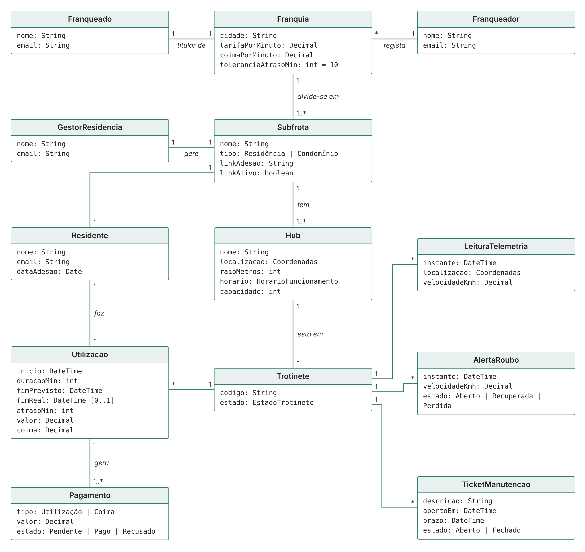
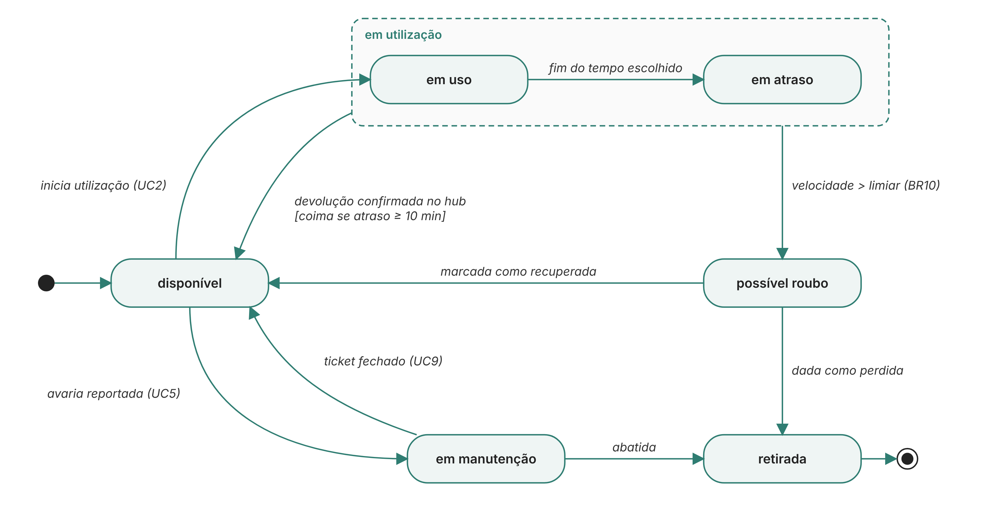

# Documentation

## Our reports

| Document | Files | Status |
| -------- | ----- | ------ |
| Product Specification (corrected product concept) | [PDF](reports/Alocar-Product-Specs.pdf) · [DOCX](reports/Alocar-Product-Specs.docx) | Draft: section 4 (architecture) still in progress; rules marked «proposta» pending group confirmation |
| QA Manual v1 | [PDF](reports/Alocar-QA-Manual-v1.pdf) · [DOCX](reports/Alocar-QA-Manual-v1.docx) | v1: stack, tools and SLOs marked «proposta» pending group confirmation |

## Diagrams

| Diagram | File |
| ------- | ---- |
| Domain class diagram | [class-diagram.png](diagrams/class-diagram.png) |
| Scooter state diagram | [scooter-state-diagram.png](diagrams/scooter-state-diagram.png) |

## Course material

- [Group project assignment guidelines](TQS26-%20Group%20project%20assignment%20guidelines.docx)
- [Service pools concretization](Service_Pools_Concretization.pdf)
- [Product Specs report template](TQS26-%20Product%20Specs%20report%20%28template%29.docx)
- [Quality Manual report template](TQS26-%20Quality%20Manual%20report%20%28template%29.docx)
- [Jira and Xray setup for basic usage](TQS26%20-%20Jira%20and%20Xray%20setup%20for%20basic%20usage.pptx)
